# Advanced

Zakładka jest przeznaczona do definiowania zaawansowanych parametrów nalotu fotogrametrycznego.

---

## **Flight Margins**

Sekcja pozwala zdefiniować nadmiar dla baz podłużnych i poprzecznych.

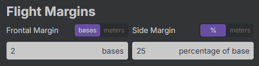{ style="display: block; margin: 0 auto;" }

---

### **Frontal Margin**

Parametr obsługuje dwa tryby:

- **`bases`** - umożliwia określenie nadmiarowej liczby baz podłużnych, które zostaną dodane na początku i na końcu każdej osi szeregu,

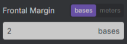{ style="display: block; margin: 0 auto;" }

- **`meters`** - pozwala na zdefiniowanie bufora (wzdłóż) wokół obszaru wewnątrz którego znajdą się wszystkie terenowe zasięgi zdjęć. 

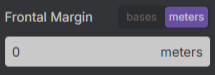{ style="display: block; margin: 0 auto;" }

---

### **Side Margin**

Parametr obsługuje dwa tryby:

- **`%`** - umożliwia określenie procentu bazy poprzecznej wystającej poza obszar dla pierwszej i ostatniej osi szeregu.

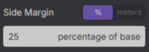{ style="display: block; margin: 0 auto;" }

- **`meters`** - pozwala na zdefiniowanie bufora (w poprzek) wokół obszaru wewnątrz którego znajdą się wszystkie terenowe zasięgi zdjęć

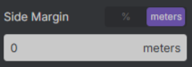{ style="display: block; margin: 0 auto;" }

---

## **Output Grid**

Rozdzielczość siatki w produktach z kontroli jakości (**`Overlap Map`** oraz **`GSD Map`**).

???+ info "Osie siatki"
    Pierwsza wartość to szerokość jednostki siatki, a druga - wysokość.

    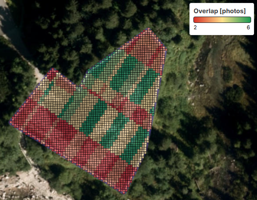
    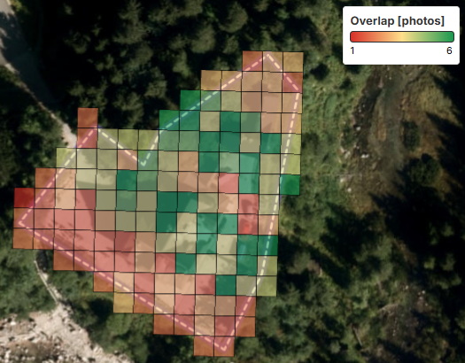
    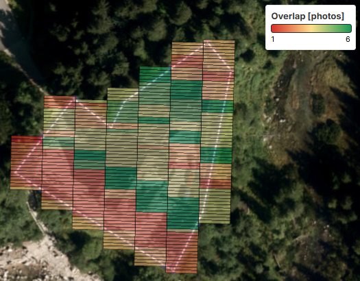

---

## **Mission Time**

Pozwala zdefiniować przewidywany czas trwania misji. Parametr wpływa na prędkość lotu zapisywaną do pliku.

???+ danger "Manewry"
    Definiowany czas nalotu **<u>nie uwzględnia manewrów</u>** statku powietrznego, takich jak: *hamowanie*, *przyspieszanie*, *dolot do punktu początkowego*, *powrót do miejsca startu*, *wykonywanie skrętu*.

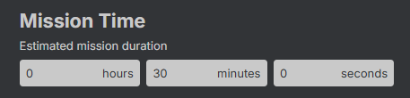{ style="display: block; margin: 0 auto;" }

???+ info "Ograniczenia prędkości lotu"
    Minimalna prędkość lotu obsługiwana przez aplikację to **`1 m/s`**, a maksymalna - **`15 m/s`**. Z tego powodu, ustawienie bardzo skrajnie długiego lub krótkiego czasu wykonywania misji może skutkować skróceniem lub wydłużeniem rzeczywistego czasu, wynikającym z tych ograniczeń.

---

## **Altitude Boundaries**

Pozwala na ustawienie najniższej (**`Lowest Terrain Elevation`**) oraz najwyższej wysokości terenu (**`Highest Terrain Elevation`**) w obszarze. Obie wartości są wyznaczane automatycznie po wczytaniu lub podaniu geometrii. W przypadku ustawienia niepożądanych wartości, można je ponownie wyznaczyć z użyciem przycisku **`Calculate heights from DTM`**.

???+ warning "Widoczność parametru"
    Parametr jest dostępny tylko wtedy, gdy wybrana jest opcja **`One Altitude ASL For Entire Flight`**.

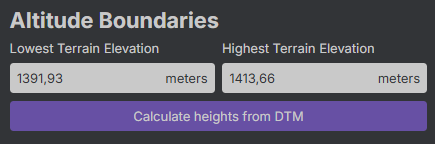{ style="display: block; margin: 0 auto;" }

---

## **Corridor Mapping**

Parametr umożliwiający podanie promienia bufora wokół linii. Wartość podstawowa: `0,01 metra`.

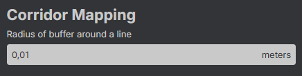{ style="display: block; margin: 0 auto;" }

???+ warning "Widoczność parametru"
    Parametr jest dostępny tylko wtedy, gdy wybrany jest tryb **`Corridor Mapping`**.