# Flight Parameters

Zakładka jest przeznaczona do definiowania parametrów nalotu fotogrametrycznego.

---

## **Camera**

Panel wyboru i zarządzania kamerami. Wybieranie odbywa się za pośrednictwem listy rozwijanej.

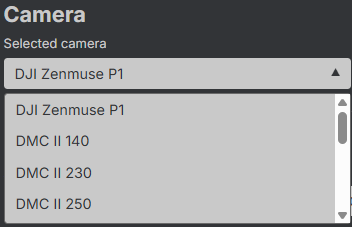{ style="display: block; margin: 0 auto;" }

---

### **Inspekcja kamery**

Przycisk **`🛈`** umożliwia wyświetlenie informacji na temat wybranej kamery.

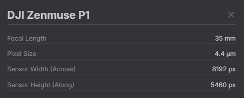{ style="display: block; margin: 0 auto;" }

---

### **Dodawanie kamery**

Przycisk **`+`** pozwala dodać nową kamerę. 

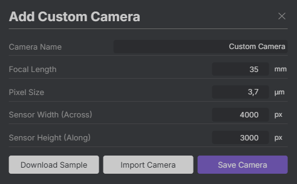{ style="display: block; margin: 0 auto;" }

W pojawiającym się oknie dostępne są trzy opcje:

- **`Download Sample`** - pobiera plik z przykładową poprawną definicją kamery. Zawartość pliku jest ustalana na podstawie aktualnie wybranego sensora. Przykładowy plik `JSON`:

```json
{
  "name": "DJI Zenmuse P1",
  "focal_length": 0.035,
  "sensor_size": 0.0000044,
  "pixels_along_track": 5460,
  "pixels_across_track": 8192
}
```

- **`Import Camera`** - umożliwia wczytanie definicji kamery z pliku. Zaleca się uprzednie pobranie wzorca z użyciem **`Download Sample`**, edytowanie zawartości w notatniku, a następnie wczytanie jej do aplikacji.

- **`Save Camera`** - umieszcza sesnor na końcu listy rozwijanej i automatycznie ustawia go jako wybrany.

---

## **Flight**

Sekcja dotycząca azymutu nalotu, pokrycia podłużnego i poprzecznego oraz sposobu definiowania rozmiaru piksela terenowego.

---

### **Strip Direction**

Suwak pozwala na wybór azymutu nalotu.

<div style="display: flex; gap: 15px; justify-content: center; align-items: center;">
    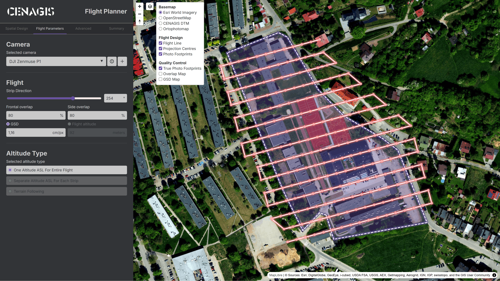
    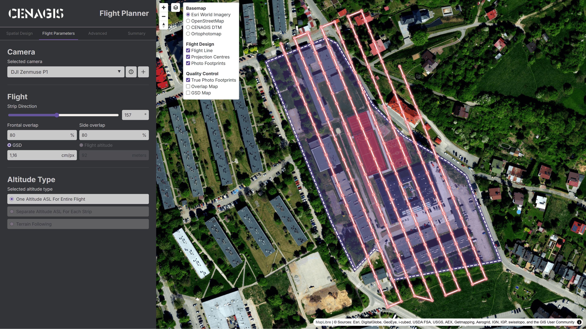
</div>

---

### **Frontal / Side Overlap**

Pokrycie podłużne (**`Frontal Overlap`**) wpływa na liczbę zdjęć w jednym szeregu, zaś pokrycie poprzeczne (**`Side Overlap`**) wpływa na liczbę szeregów.

<div style="display: flex; gap: 15px; justify-content: center; align-items: center;">
    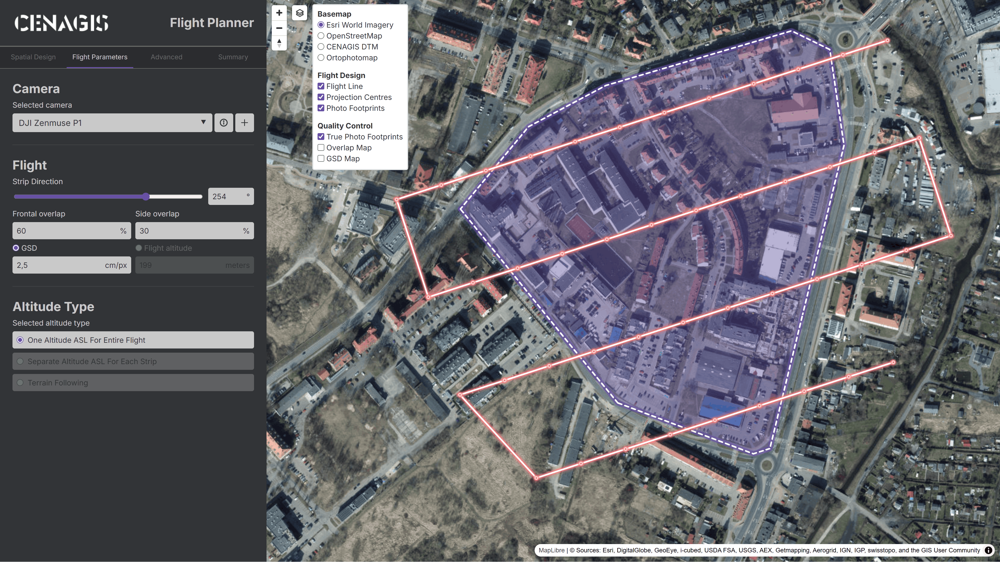
    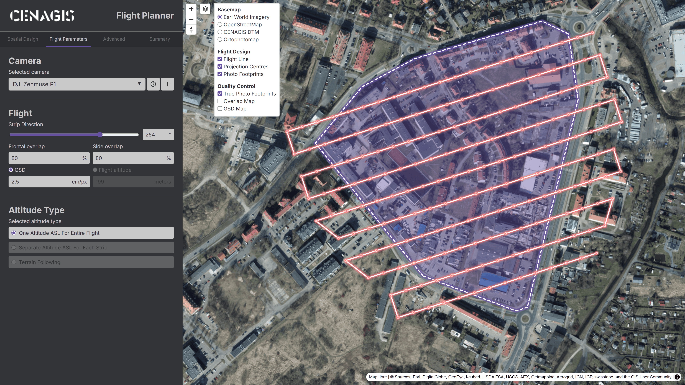
</div>

---

### **GSD / Flight altitude**

Wzajemnie zależne pola umożliwiające określenie terenowego rozmiaru piksela bezpośrednio (poprzez jego ustawienie – **`GSD`**) lub pośrednio (poprzez zmianę wysokości nalotu – **`Flight altitude`**). Pola przeliczają się dynamicznie z wykorzystaniem parametrów ustawionej kamery.

<div style="display: flex; gap: 15px; justify-content: center; align-items: center;">
    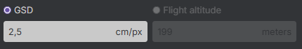
    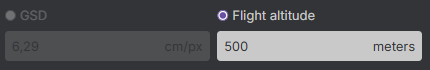
</div>

???+ warning "Precyzja GSD"
    Ze względu na fakt, iż wysokość jest zaokrąglana do pełnych metrów, przełączanie może spowodować zmianę precyzji wartości GSD.

    <div style="display: flex; gap: 15px; justify-content: center; align-items: center;">
        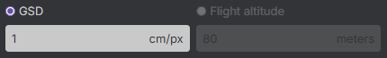
        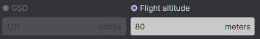
    </div>

---

# **Altitude Type**

Sekcja obsługuje trzy możliwe tryby wysokości:
- **`One Altitude ASL For Entire Flight`** – cały nalot odbywa się na jednej wysokości bezwzględnej. Zależy od minimalnej i maksymalnej wysokości terenu, którą można podać jako parametr zaawansowany. Opcja najmniej kosztowna obliczeniowo, przez co – najszybsza.

???+ warning "Minimalna i maksymalna wysokość terenu"
    Minimalna (**`Lowest Terrain Elevation`**) i maksymalna wysokość terenu (**`Highest Terrain Elevation`**) to parametry zaawansowane wyznaczanane automatycznie na podstawie numerycznego modelu terenu, można je zdefiniować ręcznie w zakładce **[Advanced](advanced.md/#altitude-boundaries)**.

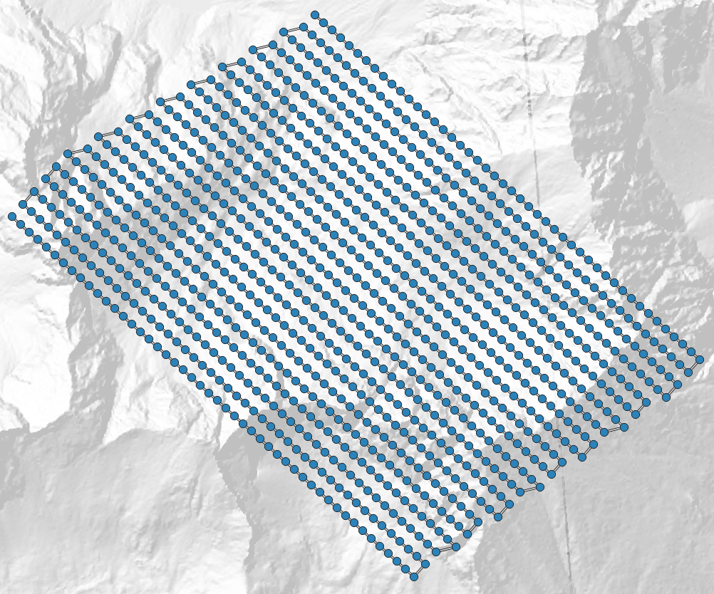{ width="50%" style="display: block; margin: 0 auto;" }

- **`Separate Altitude ASL For Each Strip`** – każdy szereg ma wyznaczoną stałą wysokość w zależności od ukształtowania terenu. Opcja bardziej kosztowna obliczeniowo.

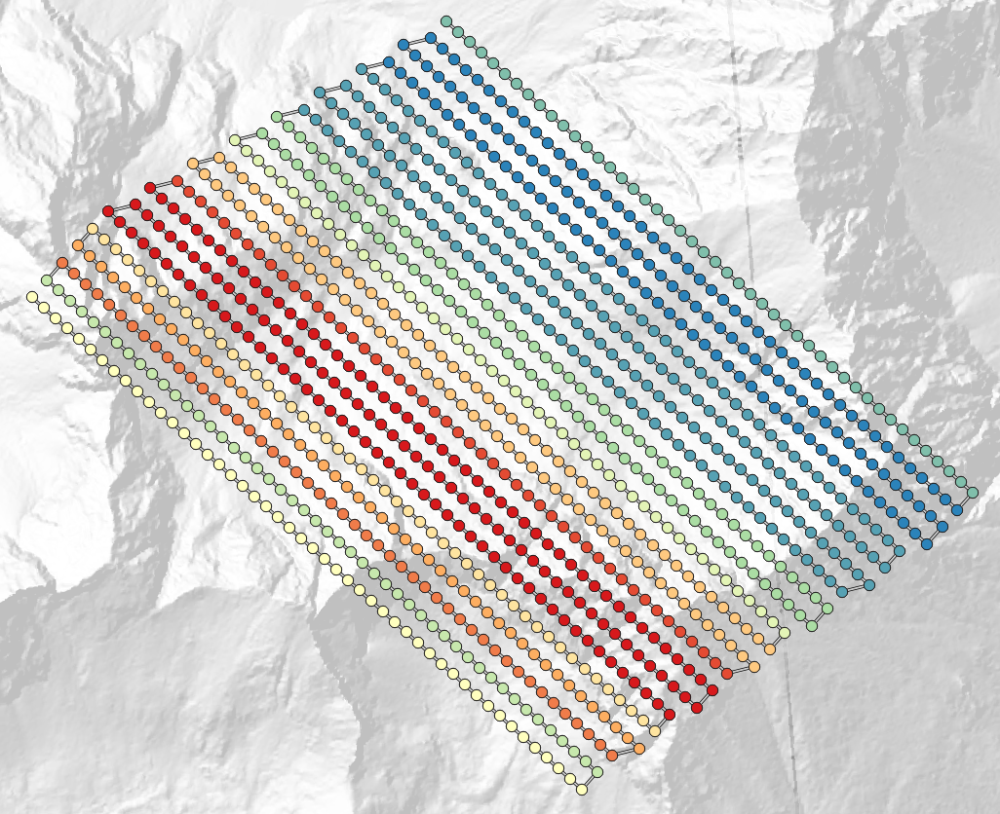{ width="50%" style="display: block; margin: 0 auto;" }

- **`Terrain Following`** – każdy środek rzutu ma niezależnie wyznaczoną wysokość, tak aby utrzymywać stałą odległość od ziemi. Opcja najbardziej kosztowna obliczeniowo, wykonująca się najdłużej, ale dająca najlepsze rezultaty.

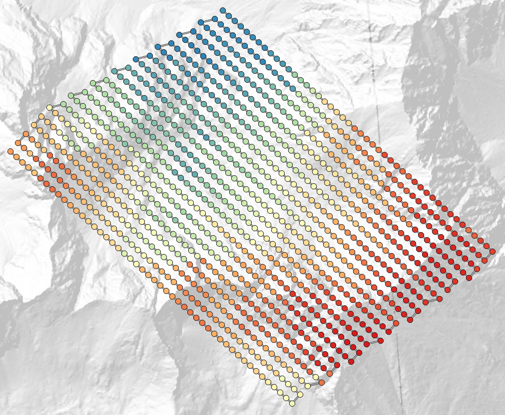{ width="50%" style="display: block; margin: 0 auto;" }