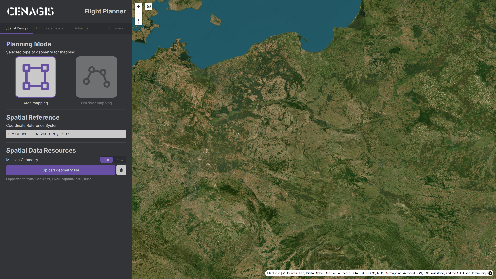

# O projekcie

**["CENAGIS – Flight Planner"]()** to przeglądarkowa wersja wtyczki ["Flight Planner" (QGIS)](https://plugins.qgis.org/plugins/flight_planner/) opracowanej w 2020 roku przez Jakuba Grucę w ramach pracy magisterskiej przygotowanej na Akademii Górniczo-Hutniczej im. Hugona Kołłątaja w Krakowie, a następnie – w 2025 roku – poddanej refaktoryzacji przez członków zespołu [UAV GeoLAB](https://uav.gik.pw.edu.pl/) z Wydziału Geodezji i Kartografii [Politechniki Warszawskiej](https://eng.pw.edu.pl/). Aplikacja umożliwia przeprowadzenie pełnego procesu planowania nalotu fotogrametrycznego nad zadanym obszarem oraz kontroli jakości otrzymanych wyników przetwarzania. Planer działa w ramach infrastruktury obliczeniowej [CENAGIS](https://cenagis.edu.pl/).

{ width="90%" style="display: block; margin: 0 auto;" }