# Interfejs mapowy

W tej części instrukcji opisano obsługę elementów interfejsu mapowego.

---

## **Czynności na mapie**

Mapa obsługuje przesuwanie, przybliżanie oraz obracanie widoku we wszystkich osiach. Niemniej, plan jest wykonywany na dwuwymiarowej geometrii, dlatego wysokości środków rzutów nie są widoczne po przechyleniu wyświetlanej sceny. Ikona **`igły magnetycznej`** umożliwia przywrócenie kierunku północy umiejscowionego w centralnej części górnej granicy obszaru mapy.

---

## **Podkład mapowy**

Panel warstw pozwala zarządzać widocznością artefaktów misji oraz wyświetlaniem podkładu mapowego. Dostępne są cztery podkłady bazowe:

- **`Esri World Imagery`** – ortofotomapa opracowana przez firmę Esri i partnerów.

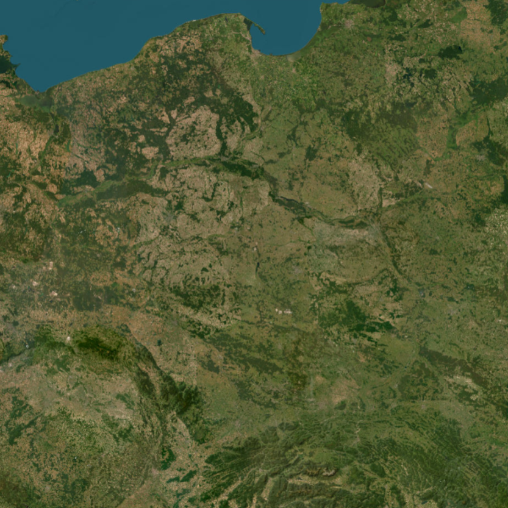{ width="400px" style="display: block; margin: 0 auto;" }

- **`OpenStreetMap`** – otwartoźródłowa mapa opracowana przez twórców OpenStreetMap.

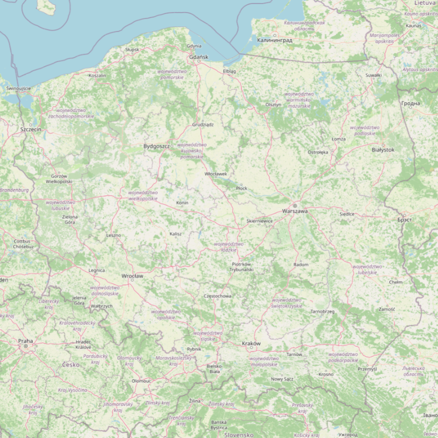{ width="400px" style="display: block; margin: 0 auto;" }

- **`CENAGIS DTM`** – numeryczny model terenu o rozdzielczości 1 x 1 metr opracowany w ramach infrastruktury obliczeniowej CENAGIS. Raster został przedstawiony jako model cieniowany.

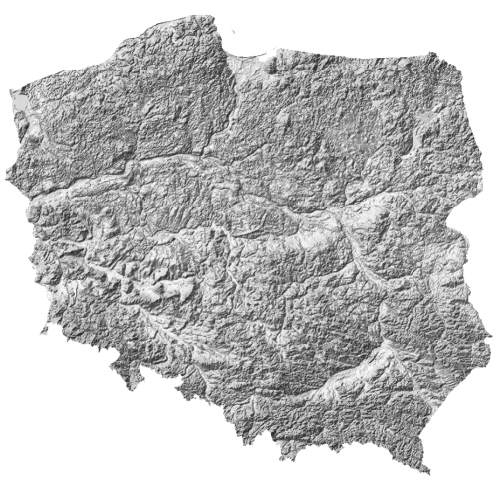{ width="400px" style="display: block; margin: 0 auto;" }

- **`Orthophotomap`** – ortofotomapa pochodząca z państwowego zasobu Głównego Urzędu Geodezji i Kartografii.

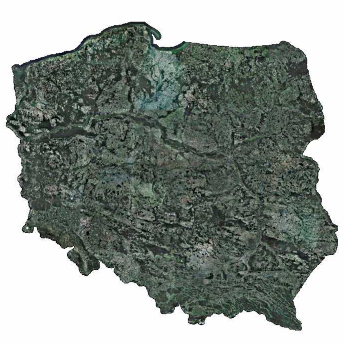{ width="400px" style="display: block; margin: 0 auto;" }

---

## **Warstwy misji**

Panel warstw obsługuje widoczność analiz w ramach projektu nalotu (**`Flight Design`**) oraz produktów pochodzących z kontroli jakości (**`Quality Control`**). Dostępne warstwy:

- **`Flight Track`** – połączone wszystkie osie szeregów (pełna linia nalotu),

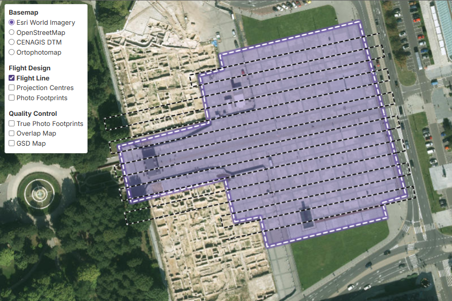{ width="50%" style="display: block; margin: 0 auto;" }

- **`Projection Centres`** – środki rzutów,

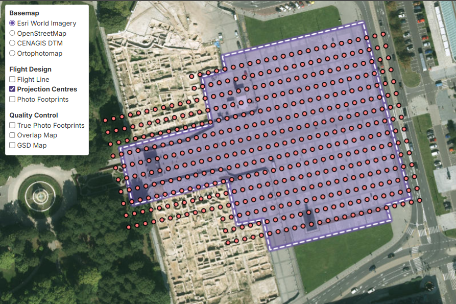{ width="50%" style="display: block; margin: 0 auto;" }

- **`Photo Footprint`** – uproszczone granice pokrycia terenu przez zdjęcia,

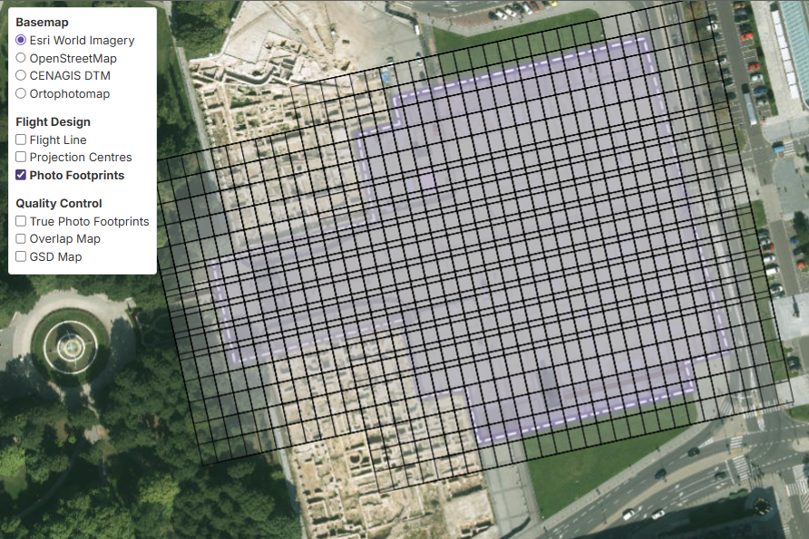{ width="50%" style="display: block; margin: 0 auto;" }

- **`True Photo Footprint`** – rzeczywiste granice pokrycia terenu przez zdjęcia,

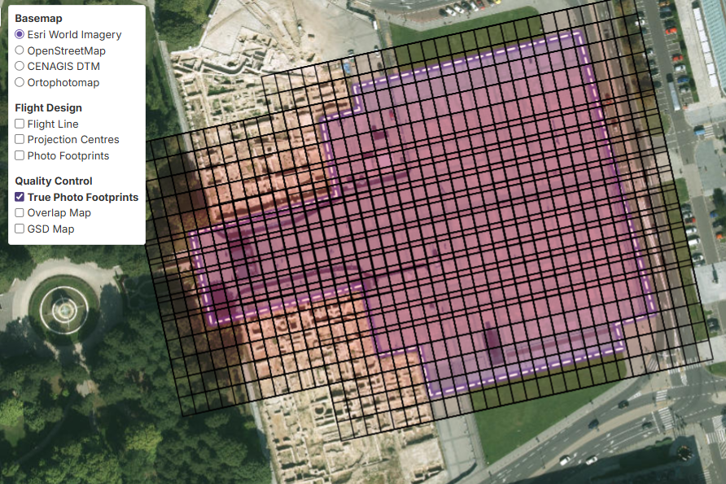{ width="50%" style="display: block; margin: 0 auto;" }

- **`Overlap Map`** – siatka prezentująca liczbę zdjęć pokrywających dany fragment terenu,

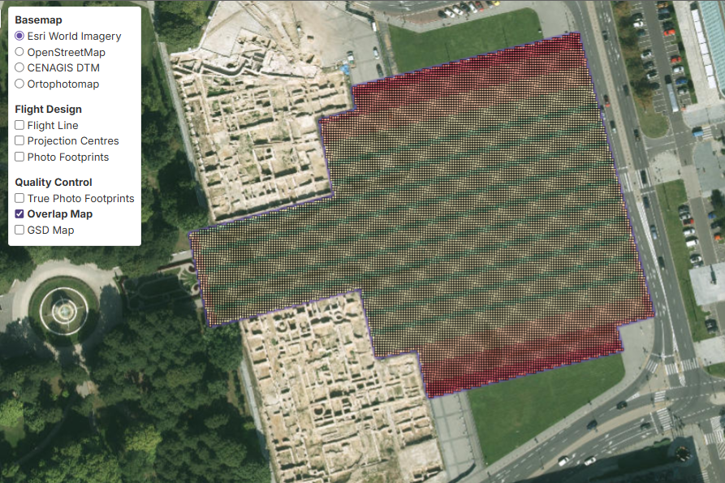{ width="50%" style="display: block; margin: 0 auto;" }

- **`GSD Map`** – siatka prezentująca piksel terenowy uzyskany w wyniku przyjętych parametrów.

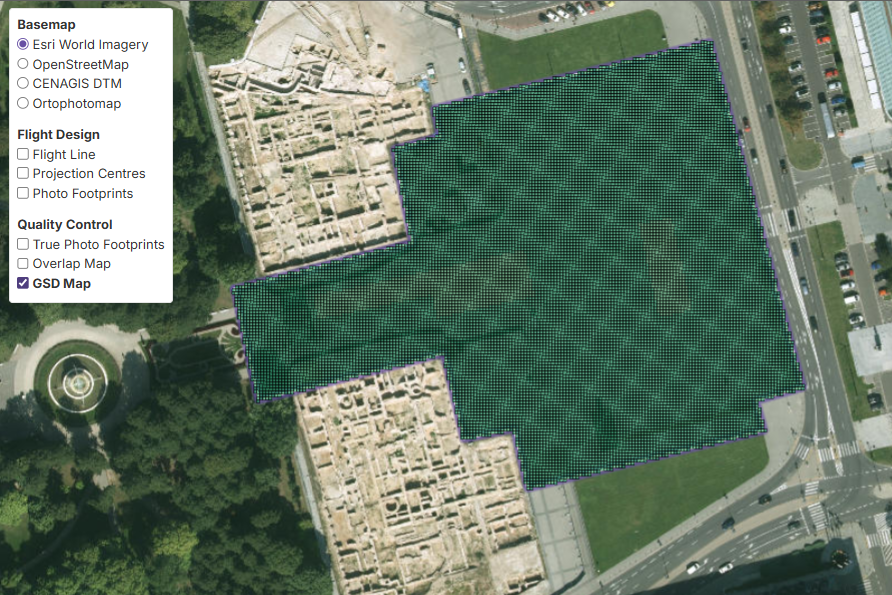{ width="50%" style="display: block; margin: 0 auto;" }

---

## **Wyświetlanie wyników**

Kliknięcie na włączoną warstwę umożliwia wyświetlenie atrybutów z nią skojarzonych.

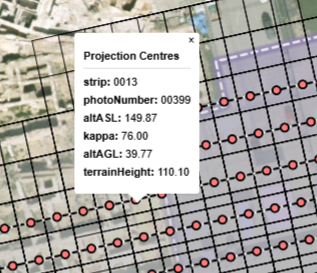{ style="display: block; margin: 0 auto;" }