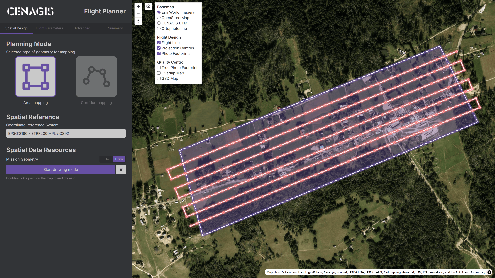
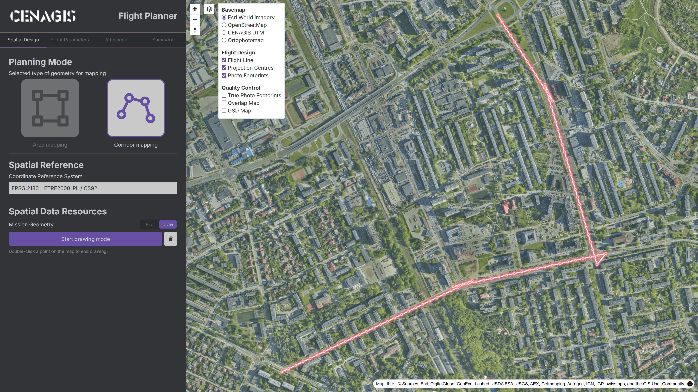
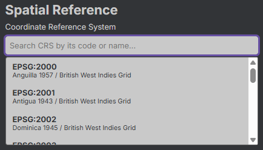
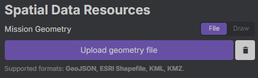
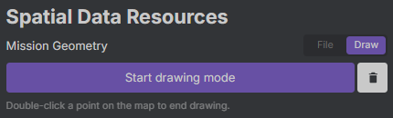

# Spatial Design

Zakładka jest przeznaczona do definiowania obszaru zainteresowania nalotu fotogrametrycznego (ang. Area of Interest, AoI).

---

## **Planning Mode**

Sekcja pozwala na wybór trybu planowania misji. Umożliwia przełączanie pomiędzy nalotem nad zadanym obszarem wyrażonym poligonem i obszarem wyrażonym linią.

???+ note "Weryfikacja geometrii"
    Aplikacja nie weryfikuje zgodności typu dostarczonej geometrii z ustawionym trybem.

    
    

???+ warning "Odległość bufora linii"
    Odległość bufora linii to parametr zaawansowany, który można zdefiniować w zakładce **[Advanced](advanced.md/#corridor-mapping)**.

---

## **Spatial Reference System**

Pole umożliwiające wybranie układu współrzędnych. Wartość można wybrać z listy rozwijalnej lub wskazać poprzez wprowadzenie pierwszych znaków nazwy albo kodu EPSG.

{ style="display: block; margin: 0 auto;" }

???+ info "Obsługiwane układy współrzędnych"
    Bieżąca wersja aplikacji działa na terenie Polski, dlatego zaleca się wybór jednego z układów współrzędnych płaskich:
    
    - **[EPSG:2180](https://epsg.io/2180)** (Układ 1992) - ETRS89 / PL-1992,
    - **[EPSG:2176](https://epsg.io/2176)** (Układ 2000 / Strefa 5) - ETRS89-POL [PL-ETRF2000] / CS2000/15,
    - **[EPSG:2177](https://epsg.io/2177)** (Układ 2000 / Strefa 6) - ETRS89-POL [PL-ETRF2000] / CS2000/18,
    - **[EPSG:2178](https://epsg.io/2178)** (Układ 2000 / Strefa 7) - ETRS89-POL [PL-ETRF2000] / CS2000/21,
    - **[EPSG:2179](https://epsg.io/2179)** (Układ 2000 / Strefa 8) - ETRS89-POL [PL-ETRF2000] / CS2000/24.

---

## **Spatial Data Resources**

Sekcja odpowiedzialna za zarządzanie geometrią obszaru zainteresowania. Pole **`File`**/**`Draw`** umożliwia przełączanie źródła pomiędzy plikiem a rysunkiem. Dostępne są następujące opcje:

- **`Upload geometry file`** – pozwala na wybranie pliku `GeoJSON`, Esri Shapefile (`SHP`), `KML` lub `KMZ`,
- **`Start drawing mode`** – umożliwia włączenie trybu rysowania. Po aktywacji, przycisk zmienia status. W interfejsie mapowym należy klikać kolejne punkty oraz wskazać punkt końcowy dwuklikiem.

    
    

???+ warning "Usuwanie geometrii"
    Kliknięcie przycisku z ikoną kosza powoduje bezpowrotne usunięcie aktualnie wyświetlanej geometrii z interfejsu mapowego.