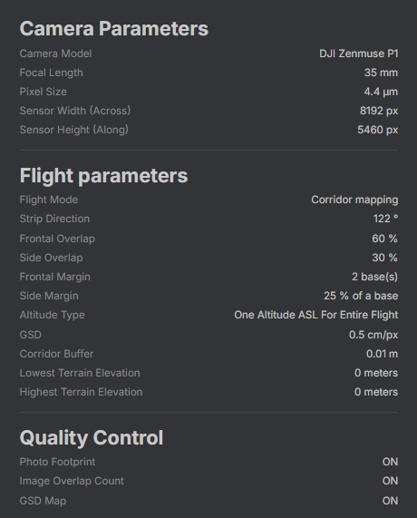
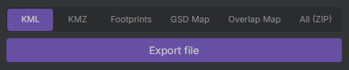

# Summary

Zakładka jest przeznaczona do weryfikacji ustawionych parametrów, uruchamiania planowania nalotu oraz eksportowania wyników.

---

## **Podsumowanie**

Panel podsumowania ustawionych parametrów. Umożliwia weryfikację przed uruchomieniem przetwarzania.

{ style="display: block; margin: 0 auto;" }

---

## Przycisk 'Plan a flight'

Przycisk wyzwalający planowanie misji fotogrametrycznej. Po uruchomieniu, zmienia status na **`Calculating...`**

    
    

---

## Panel eksportu

Segment dostępny po zakończeniu obliczeń w ramach procedury planowania. Umożliwia sześć opcji eksportu:

- środki rzutów w postaci **`pliku KML`** zgodnego z oprogramowaniem DJI,
- misja w postaci **`pliku KMZ`** zgodnego z oprogramowaniem DJI,
- rzeczywisty zasięg zdjęć w postaci **`pliku GeoJSON`**,
- mapa terenowego rozmiaru piksela zapisana jako siatka w postaci **`pliku GeoJSON`**,
- mapa pokryć zdjęciami zapisana jako siatka w postaci **`pliku GeoJSON`**,
- wszystkie powyższe pliki zapisane jako **`folder skompresowany ZIP`**.

{ style="display: block; margin: 0 auto;" }