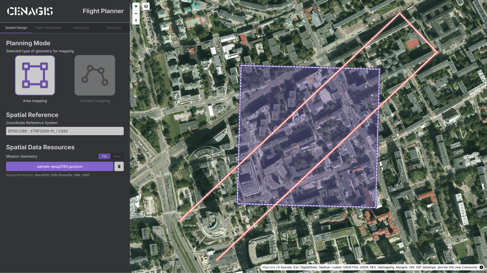
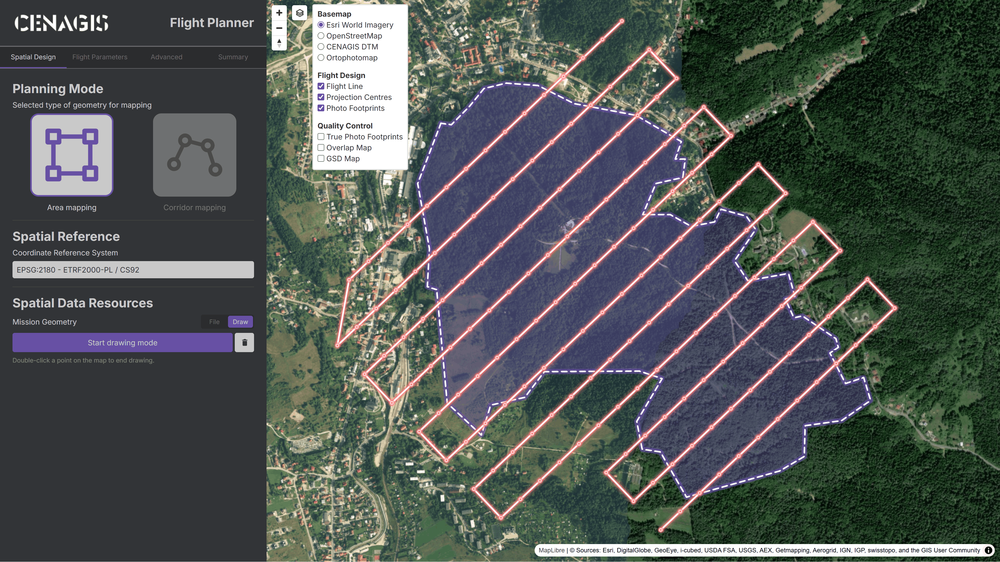
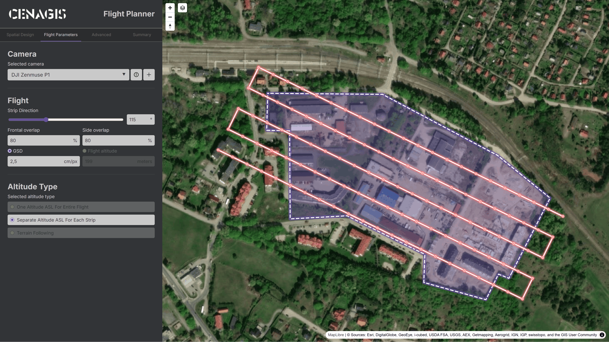
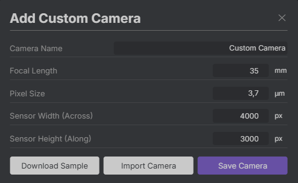
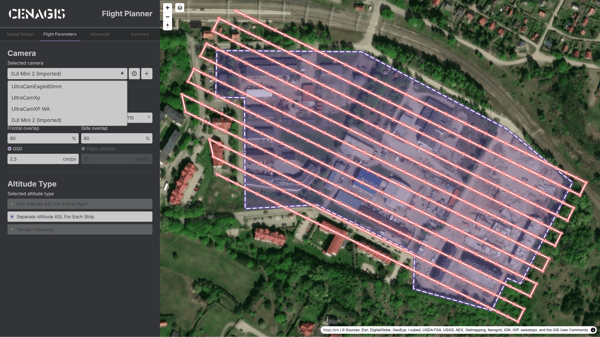
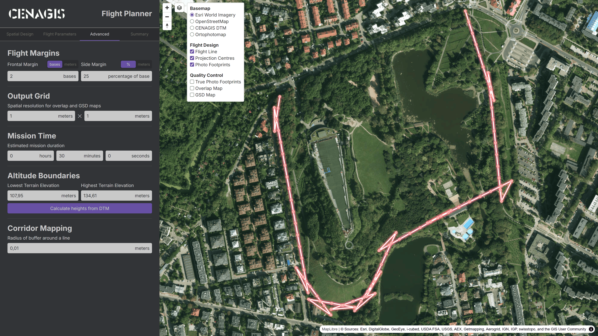
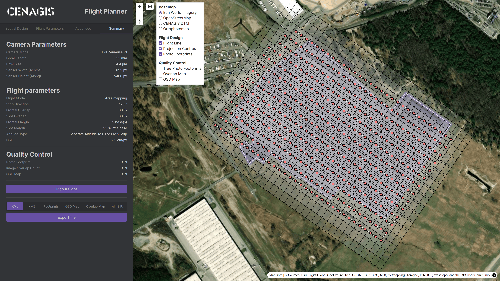
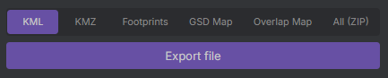

# Szybki start - Planowanie nalotu fotogrametrycznego

Interfejs aplikacji jest podzielony na **4 główne zakładki** – zaleca się przechodzenie przez kolejne ekrany.

---

## **Spatial Design** – dane przestrzenne do nalotu

W pierwszej kolejności należy wybrać, czy planowanie odbywa się nad **obszarem (`Area mapping`)** czy nad **obiektem liniowym (`Corridor mapping`)**. Po podaniu odpowiedniego układu współrzędnych, należy wybrać źródło geometrii – **plik (`File`)** lub **ręczny rysunek (`Draw`)**.

???+ info "Podgląd geometrii"
    Poprawnie dodana geometria zostaje automatycznie wyświetlona wraz z dynamicznym podglądem linii nalotu oraz środków rzutów w postaci czerwonych kropek.

---

### **File** – geometria z pliku

Należy wybrać opcję **`Upload geometry file`** i wskazać odpowiedni plik z dysku.

{ width="75%" style="display: block; margin: 0 auto;" }

---

### **Draw** – geometria narysowana przez użytkownika

Należy wybrać opcję **`Start drawing mode`** i rozpocząć wskazywanie punktów. Rysowanie kończy **dwukrotne kliknięcie punktu** na podglądzie mapowym.

{ width="75%" style="display: block; margin: 0 auto;" }

---

## **Flight Parameters** – parametry kamery oraz nalotu

W zakładce można:

- wybrać kamerę (parametry dostępne po kliknięciu przycisku **`🛈`**),
- ustawić azymut nalotu,
- pokrycie poprzeczne i podłużne,
- terenowy rozmiar piksela lub wysokość nalotu,
- zdefiniować sposób wyznaczania wysokości środków rzutu względem terenu.

{ width="75%" style="display: block; margin: 0 auto;" }

---

### Nowa kamera

Kliknięcie przycisku **`+`** umożliwia zdefiniowanie własnej kamery. Po wypełnieniu wszystkich wymaganych pól należy wybrać opcję zapisu (**`Save Camera`**).

{ width="40%" style="display: block; margin: 0 auto;" }

???+ info "Eksport i wczytywanie własnej kamery"
    Aplikacja obsługuje możliwość dodania kamery z pliku. W tym celu można pobrać próbkę aktualnie wybranego sensora przyciskiem **`Download Sample`**, zmodyfikować zawartość pliku przy użyciu notatnika, a na koniec wczytać plik przyciskiem **`Import Camera`**.

    Przykładowa zawartość pliku kamery:
    ```json
    {
      "name": "DJI Zenmuse P1",
      "focal_length": 0.035,
      "sensor_size": 0.0000044,
      "pixels_along_track": 5460,
      "pixels_across_track": 8192
    }
    ```

Dodana kamera zostaje automatycznie wybrana i pojawia się na samym końcu rozwijalnej listy. Powoduje to także dynamiczne przeliczenie podglądu linii nalotu oraz środków rzutów.

{ width="75%" style="display: block; margin: 0 auto;" }

???+ warning "Przechowywanie danych użytkownika"
    Ponowne uruchomienie aplikacji **usuwa** wszystkie dodane przez użytkownika kamery.

---

## **Advanced** – zaawansowane parametry przetwarzania

Zakładka umożliwia:

- modyfikowanie marginesów nalotu,
- modyfikowanie terenowego rozmiaru piksela siatki wyników kontroli jakości,
- definiowanie czasu trwania misji, 
- definiowanie skrajnych wysokości nalotu (tylko w trybie **`One Altitude ASL For Entire Flight`**),
- definiowanie odległości bufora wokół obiektu liniowego (tylko w trybie **`Corridor mapping`**).

{ width="75%" style="display: block; margin: 0 auto;" }

---

## **Summary** - kontrola parametrów i uruchomienie przetwarzania

Ostatni etap przetwarzania pozwala na kontrolę ustawionych parametrów i uruchomienie planowania misji (**`Plan a flight`**). Aplikacja informuje o trwających obliczeniach poprzez wyświetlanie napisu **`Calculating...`**. Na koniec wyświetlana jest linia nalotu (**`Flight Line`**), środki rzutów (**`Projection Centres`**) oraz uproszczone granice pokrycia terenu przez zdjęcia (**`Photo Footprints`**). W celu wyświetlenia wyników kontroli jakości, tj. rzeczywistego zasięgu terenowego zdjęcia (**`True Photo Footprints`**), mapy pokryć zdjęciami (**`Overlap Map`**) 
oraz mapy terenowego rozmiaru piksela (**`GSD Map`**) należy rozwinąć panel warstw i zaznaczyć/odznaczyć odpowiednie pozycje.

{ width="75%" style="display: block; margin: 0 auto;" }

---

### **Export file** - zapisywanie wyników

Aplikacja pozwala na eksport następujących plików:

- środków rzutów w postaci **`pliku KML`** zgodnego z oprogramowaniem DJI,
- całej misji w postaci **`pliku KMZ`** zgodnego z oprogramowaniem DJI,
- rzeczywistych zasięgów zdjęcia w postaci **`pliku GeoJSON`**,
- mapy terenowego rozmiaru piksela zapisanej jako siatka w postaci **`pliku GeoJSON`**,
- mapy pokryć zdjęciami zapisanej jako siatka w postaci **`pliku GeoJSON`**,
- wszystkich powyższych plików zapisanych jako **`folder skompresowany ZIP`**.

{ width="40%" style="display: block; margin: 0 auto;" }